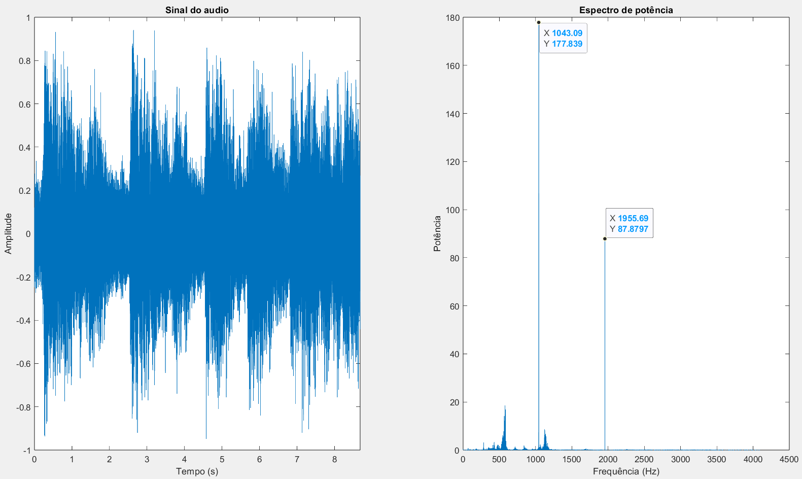
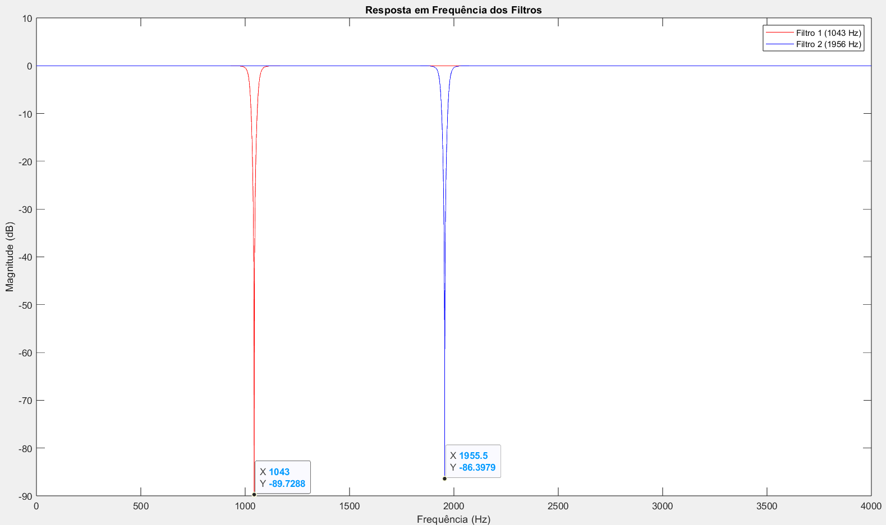
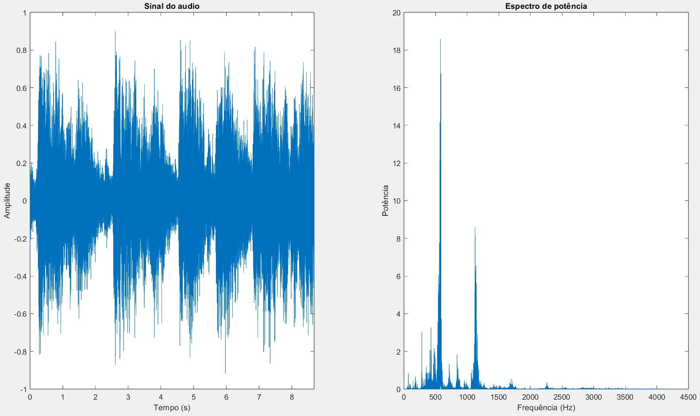

# Audio Signal Processing in MATLAB

> **Made with MATLAB.** All the code in this repository is written in MATLAB.

A set of MATLAB functions for working with audio signals using the **FFT**, plus a script that removes tonal noise from an audio file with **Butterworth band-stop filters**. With these functions it is possible to:

- record, import and play audio;
- plot a signal in time and in frequency (power spectrum);
- recognize whether a voice is **male or female**;
- find noise in a spectrum and **filter it out**.

> Project developed for the course **Signal Processing**, BSc in **Electrical and Computer Engineering**, **Instituto Politécnico do Cávado e Ave (IPCA)**, **3rd year**.

---
 
## Repository structure

```
.
├── functions/
│   ├── recordAudio.m
│   ├── importAudio.m
│   ├── playAudio.m
│   ├── calcFFT.m
│   ├── plotAudioSignal.m
│   └── genderIdentification.m
├── filtragem_som.m         # noise removal script
├── images/                 # plots of the results
└── README.md
```

---

## Functions

| Function | What it does |
|---|---|
| `recordAudio(tempo_s)` | Records audio from the microphone and saves it to a file |
| `[D, Fs] = importAudio(audio)` | Loads an audio file |
| `playAudio(D, Fs)` | Plays the audio |
| `[f, P] = calcFFT(D, Fs)` | Computes the one-sided power spectrum of a signal |
| `plotAudioSignal(D, Fs)` | Plots the signal in time and its power spectrum |
| `genderIdentification(D, Fs)` | Recognizes the gender of a voice |

Throughout, `D` is the array of audio samples (with `N` samples) and `Fs` is the sampling frequency in Hz.

### `recordAudio(tempo_s)`

Records `tempo_s` seconds of audio from the computer's microphone and saves it as `audio_gravado.mp3`.

- The recording is made at **8000 Hz, 16 bits, 1 channel (mono)**, using `audiorecorder`.
- The recording is blocking (`recordblocking`): the function only returns when the recording is over.
- The samples are obtained with `getaudiodata` and written to disk with `audiowrite`.
- It uses the microphone with ID `1`. To see the available input devices, use `audiodevinfo` (there are commented lines in the code for this).

```matlab
recordAudio(5);      % records 5 seconds
```

### `[D, Fs] = importAudio(audio)`

Loads the audio file whose name is given as a string (`.mp3`, `.wav`, ...), with `audioread`. It returns the samples `D` and the sampling frequency `Fs`.

```matlab
[D, Fs] = importAudio('audio_gravado.mp3');
```

### `playAudio(D, Fs)`

Plays the audio with `sound`. Note that `sound` does not wait for the audio to finish, so if you need to play something right after it, wait for the duration of the audio (`length(D)/Fs` seconds).

### `[f, P] = calcFFT(D, Fs)`

Computes the **one-sided power spectrum** of the signal. It returns the frequency axis `f` and the power `P` at each frequency, from 0 Hz up to the Nyquist frequency `Fs/2`. The other functions rely on it.

How it is computed:

1. The FFT of the signal is calculated with `fft`.
2. The power is the squared magnitude of the FFT, normalized by the number of samples.
3. Only the frequencies from 0 Hz to `Fs/2` are kept, since the negative half of the spectrum is redundant for a real signal.
4. The kept values are doubled to recover the energy of the discarded half, except 0 Hz and `Fs/2`, which have no negative counterpart.

The formulas are in the [Formulas](#formulas) section.

### `plotAudioSignal(D, Fs)`

Opens a figure with two plots side by side:

- **Left:** the signal against time.
- **Right:** the power spectrum, computed with `calcFFT`.

Examples of its output are shown further down, in the noise removal section.

### `genderIdentification(D, Fs)`

Recognizes whether a voice recording is male or female, and prints the result: `Género identificado: Masculino` or `Género identificado: Feminino`.

1. It computes the power spectrum with `calcFFT`.
2. It finds the **dominant frequency**, the frequency with the highest power.
3. It computes the distance from the dominant frequency to a reference frequency for each gender: **125 Hz** for male and **200 Hz** for female.
4. The gender with the closest reference is the result.

Since the two references are 75 Hz apart, the decision limit is the midpoint, **162.5 Hz**: a dominant frequency below it is classified as male, and from it upwards as female.

### Example

```matlab
recordAudio(5);                             % record 5 seconds -> audio_gravado.mp3
[D, Fs] = importAudio('audio_gravado.mp3');
playAudio(D, Fs);
plotAudioSignal(D, Fs);
genderIdentification(D, Fs);
```

---

## Noise removal script: `filtragem_som.m`

The script cleans an audio file (`handel_J.wav`) that is corrupted with noise, using the functions above. It does the following:

1. **Imports and plays** the noisy audio.
2. **Plots the signal and its power spectrum** with `plotAudioSignal`. The spectrum has two isolated, very strong peaks, which are the noise: one at **1043.09 Hz** and the other at **1955.69 Hz**.

   

3. **Designs two Butterworth band-stop filters**, one for each noise frequency, with `butter(2, Wn, 'stop')`. Each one rejects a **50 Hz** wide band centered on the noise peak. MATLAB doubles the order of band filters, so each filter is of 4th order. Butterworth filters were chosen because their response is maximally flat in the passband, so the frequencies to keep are not distorted by ripples.
4. **Plots the frequency response** of both filters, using `freqz` and converting the magnitude to dB. Both are flat at 0 dB, except at the noise frequencies, where the attenuation reaches about **−90 dB** (1043 Hz) and **−86 dB** (1956 Hz).

   

5. **Filters the signal in cascade** with `filter`: the first filter is applied to the original signal, and the second one to the result.
6. **Plots the filtered signal and its spectrum**. The two noise peaks are gone, while the rest of the audio content is preserved.

   

7. **Plays the original audio, waits for it to end, and then plays the filtered one**, to compare them.

---

## Formulas
 
All the formulas used in the code.
 
**Power spectrum** (`calcFFT`), where $`x[n]`$ are the $`N`$ samples of the signal:
 
```math
X[k] = \sum_{n=0}^{N-1} x[n] \, e^{-j 2\pi k n / N}
```
 
```math
P[k] = \frac{|X[k]|^2}{N}
```
 
**One-sided spectrum**, doubling the values to compensate for the discarded negative frequencies:
 
```math
P_1[k] =
\begin{cases}
P[k], & k = 0 \text{ or } k = N/2 \\
2 P[k], & 0 < k < N/2
\end{cases}
```
 
**Frequency axis** (`calcFFT`):
 
```math
f[k] = \frac{k \cdot F_s}{N}, \qquad k = 0, 1, \dots, \left\lfloor \frac{N}{2} \right\rfloor
```
 
**Time axis** (`plotAudioSignal`):
 
```math
t[n] = \frac{n}{F_s}, \qquad n = 0, 1, \dots, N-1
```
 
**Dominant frequency and gender** (`genderIdentification`):
 
```math
f_{dom} = f[k_{dom}], \qquad k_{dom} = \arg\max_k P_1[k]
```
 
```math
d_M = |f_{dom} - 125| \qquad d_F = |f_{dom} - 200|
```
 
```math
\text{gender} =
\begin{cases}
\text{male}, & d_M < d_F \\
\text{female}, & \text{otherwise}
\end{cases}
```
 
**Normalized cutoff frequencies** of each band-stop filter (`filtragem_som.m`), with a band width $`\Delta = 50`$ Hz and the noise frequency $`f_{noise}`$:
 
```math
W_n = \left[ \frac{f_{noise} - \Delta/2}{F_s/2}, \ \frac{f_{noise} + \Delta/2}{F_s/2} \right]
```
 
**Butterworth magnitude response**, for the low-pass prototype of order $`n`$ and cutoff $`\omega_c`$ (the band-stop filters are obtained from it by a frequency transformation, done by `butter`):
 
```math
|H(j\omega)|^2 = \frac{1}{1 + (\omega/\omega_c)^{2n}}
```
 
**Magnitude in dB** (frequency response plot):
 
```math
|H(f)|_{dB} = 20 \log_{10} |H(f)|
```
 
**Cascade of the two filters**:
 
```math
Y(z) = H_2(z) \, H_1(z) \, X(z)
```
 
---

## Requirements

- **MATLAB**, with the **Signal Processing Toolbox** (`butter` and `freqz`).
- A microphone, to use `recordAudio`.
- For `filtragem_som.m`, the noisy audio file `handel_J.wav` in the same folder as the script. The file is not included in this repository.

Run `filtragem_som.m` with the repository folder as the current folder. The script adds the `functions` folder to the MATLAB path.

---

## Notes and limitations

- Gender recognition only uses the strongest peak of the whole recording. This assumes it is the fundamental frequency of the voice, so harmonics or background noise can lead to a wrong result.
- The noise frequencies in the script are fixed, found by looking at the spectrum of this particular file. A different recording would need its own frequencies.
- Messages and comments in the code are in Portuguese.

---

## Author

**Ivo Azevedo**
